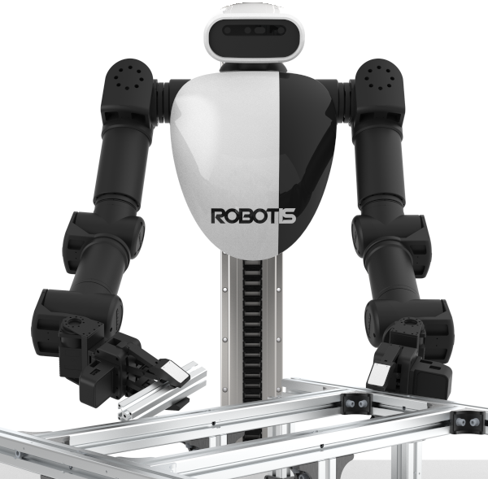
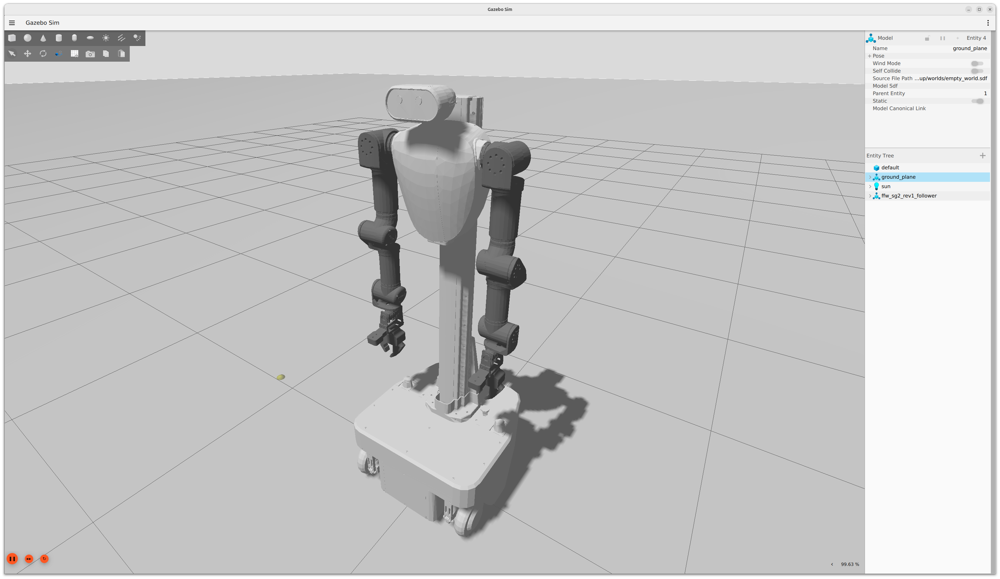

# Physical AI 応用1 最終課題

テーマ：双腕ロボットROBOTIS AI Worker SG2を使ったsim環境でのホワイトボードの掃除

OmniCampus account：chocopan

email：chocopanium@gmail.com

提出日：2026-10-31

GitHub repo：https://github.com/choconium/physical-ai-advanced1

## 1. 検討結論

オフィスにあるAIWorker-SG2と同型の公式Gazeboモデルで、ホワイトボードの文字を消すための「モーション計画・実行・工具座標・被覆」のテストサンプルは実装できた。双腕ロボットSG2の右腕を使用し、MoveItで衝突を検査した軌道をGazeboの右腕controllerへ実行して、実測TFに応じて文字セルを消す試験に成功した。

ただし実物の顔料を消す物理ではなく、幾何学的消去代理モデルである。接触点は板の5mm手前に設定している。接触力、摩擦、消し具のたわみ、把持滑りは評価していない。実機で文字を消せることの実証や、完成したSim-to-Real制御器とは扱わない。

## 2. システムとAI

公式AIWorker 2.3.1、SG2、ROS 2 Jazzy、Gazebo Harmonic、MoveItを使う。MoveItの起動はmodel:=sg2を明示する。既定bg2のままSG2を計画する設定にはしない。groupはarm_r、EEはend_effector_r_link、controllerはarm_r_controllerのFollowJointTrajectory。

図1にAI Workerの外観参考、図2にGazebo上のSG2モデルを示す。双腕・頭部・胴体の形状と、SG2の移動台座の構成を確認できる。図はロボット形状の説明用で、ホワイトボード消去の実演結果は第3章の実測と第7章の動画で示す。

ホワイトボードは36×30cm、文字は約20×10cmのAIを27個の黒いセルで表した。板の衝突形状はGazeboとMoveItの両方へ登録し、消し具の取付collisionもMoveItへ登録する。Gazebo上の青い工具は実測TFに追従するvisual proxyであり、力学的に把持・変形する工具ではない。

AIはQ-learningによる固定3帯の順序選択で、同梱の学習器（src/gazebo_aiworker_patrol）を利用する。現在帯・訪問済み集合を状態にし、seed=20261030、4000 episodeで簡略グラフを学習する。文字画像やdirty maskは方策の入力にしていない。ログのdirty_cellsは残存数の記録であり、画像認識や消し残しに応じた適応的再消去を実装したとは主張しない。

各帯では、OMPLの衝突判定付き接近計画を実行した後、接近・板前移動・往路・復路・退避の5本をCartesian計画する。折返しを1本の軌道にすると時刻付けが失敗したため、折返しで停止する別セグメントとして計画・実行した。各path fractionが0.999未満なら実行しない。

## 3. 消去判定と実測

20Hzのtimerで実測TFを確認する。TFが欠落、古い、または時計系が違う場合は消去せず、拒否回数・理由を残す。工具接触点が板のロボット側0〜8mm、法線から10度以内で、70×45mmのfootprintに筆跡セルが入った場合だけ消去する。板を貫通した点は得点対象にしない。Gazeboがセルの削除を確認した後に内部maskを更新する。

| 指標 | 録画したwipe06の実測 |
| --- | --- |
| 完了帯 | 3 / 3 |
| Cartesian経路 | 15本、すべてfraction=1.0 |
| 消去セル | 27 / 27、残存0 |
| 生成maskの筆跡画素 | 5292 → 0 |
| 幾何学的消去率 | 100% |
| 実行時間 | 101.90秒 |
| 有効な実測工具サンプル | 2017 |
| TF拒否サンプル | 4、消去処理なし |
| 単体テスト | 10件成功 |

独立のaudit_run.pyで、27件の削除が重複せず、実測接触点の位置・姿勢・footprint条件を満たすこと、全15経路と3帯が完了したことを照合した。maskは仮想セルから生成したもので、実カメラ画像のセグメンテーション精度ではない。録画runの実測ログ・mask・方策はevidence/wipe06、集計とハッシュはRESULTS.jsonに保存した。

## 4. 失敗から得た設計変更

| 試行 | 結果 | 得られたこと |
| --- | --- | --- |
| wipe01 | 0セル、計画失敗 | 板近傍での軌道検証失敗を受け入れず停止 |
| wipe02 | 0セル、時刻付け失敗 | 180度折返しを別セグメントへ分割 |
| wipe03 | 11/27セル、Cartesian fraction不足 | 不完全な経路を送らず停止 |
| wipe04 | 11/27セル、次帯IK失敗 | 手首カメラ・arm_r_link7と板の干渉を特定 |
| wipe05 | 27/27セル、102.01秒 | 工具姿勢変更後の3帯を完走 |
| wipe06 | 27/27セル、101.90秒 | 新しいコンテナから再実行し録画 |

旧案はidentity姿勢で工具をEEの+Xへ横付けする仮定だったが、下の帯では手首カメラが板と衝突した。衝突チェックを無効化せず、グリッパのlocal -Zを板に向ける末端取付へ変更した。

採用した仮想工具はEE→contactが[0,0,-0.08]m、相対回転Ry(+90度)。EEはRy(-90度)をとる。contact frameの+Xはworldの板方向+Xとなり、EE x=.435に対してcontact x=.515、板面x=.520で整合する。実物の取付・厚さ・重量は未測定なので、実機ではこの8cmを校正し直す。

開発中にコード・工具モデルが変わった試行を混ぜた成功率は評価しない。最終モデルの確認は2試行であり、多様な板位置・文字・把持条件への一般化を示す回数ではない。

## 5. Sim-to-Realで再利用するもの

config/transfer.example.jsonのboard frame、EE→工具変換、工具寸法、standoff、stroke座標を共通入力にした。sim runnerはその幾何パスを実際に使い、同じ経路をJSONへ出力する。export_transfer.pyは平行移動・回転に対応し、直交性、右手系、工具footprintと帯間隔、宣言された板寸法の範囲を検査する。

任意の校正ファイルから出力できるが、これは命令を送らない幾何パスであり、実機の可到達性や衝突・接触力を保証しない。実行runnerは固定sim profileとdomain64に限定する。実機へ移すには、SG2のソフト更新、controller契約、工具固定・TCP・板面校正、planning scene、非接触dry-run、接触制御、実画像のafter評価が必要である。手順はSIM_TO_REAL.mdへ記載した。

MoveItで軌道を作るだけでは押付け力は決まらない。力覚・admittanceや受動コンプライアンスを使う場合も、SG2の実機構成とvendor制御の確認が別途必要である。今回、オフィスの実機には接続していない。

## 6. 加点要素との対応

| 観点 | このサンプルで示すもの |
| --- | --- |
| 創造性 | 単なる腕の往復ではなく、AIの帯選択・被覆・消去状態・実機移植用座標を一体化 |
| 技術力 | 同型SG2、OMPL/Cartesian計画、工具・板のcollision、TF鮮度と姿勢判定、実行結果の照合 |
| 実用性 | 小領域のホワイトボード清掃に向けた、工具TCPとboard frameを差し替える検証基盤 |
| 表現力 | 実際の腕と文字が減る様子だけの動画、説明と限界はレポートへ分離 |

加点を保証するものではない。特に、sim内の代理モデルと実物の清掃性能を区別することを優先した。

## 7. 実演と提出

動画はmedia/whiteboard_wipe.mp4、95.75秒、等速、1280×640・24fps。単一の成功runから実際の動作区間を使った。初期GUI同期区間を除外する際は、最初の消去イベントを隠さないことを検査した。実画面の取得フレームから録画時刻を正規化し、スライド・静止画による時間調整・同一動作の複製は加えていない。原本・編集区間・完成動画のハッシュはmedia JSONに残した。

再現手順はREADME.md、コード・設定・テスト・PDF・動画を同じ公開リポジトリへ収録した。公開版は依存する学習器・録画編集ツール・Docker定義も同梱し、このリポジトリ単独で再実行する構成とした。

## 参考資料

- ROBOTIS Gazebo/MoveIt: https://docs.robotis.com/docs/systems/aiworker/simulation/gazebo/
- 実行source revision: https://github.com/ROBOTIS-GIT/ai_worker/tree/691db567f873edca340eea01f190a28935782412
- 接触制御の参考: https://control.ros.org/jazzy/doc/ros2_controllers/admittance_controller/doc/userdoc.html
